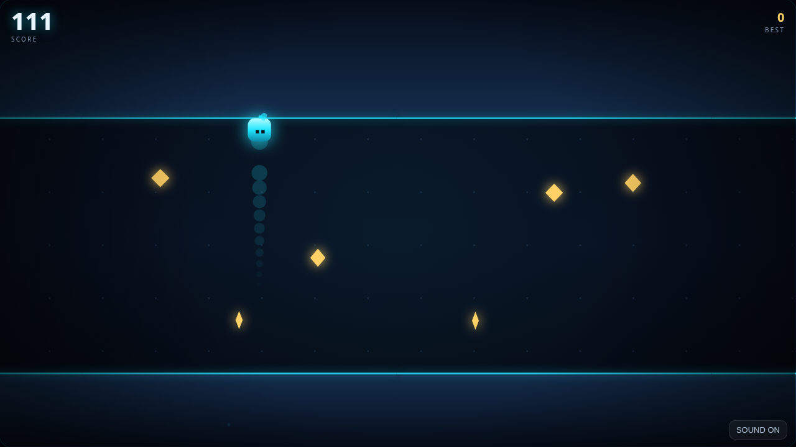

# Gravity Shift

A one-touch gravity-flip runner that runs in any browser, offline, with no game engine and no dependencies.

You never stop moving. Tap, click or press space to flip gravity and run the ceiling or the floor. Spikes sit on both surfaces, the shaft keeps speeding up, and every shard you snag raises the combo multiplier. One mistake ends the run.



## Play it

| Build | Link |
| --- | --- |
| Contest entry (Base44 app) | https://gravity-shift-a2b09350.base44.app |
| Standalone web build (GitHub Pages) | https://saharrison2100.github.io/gravity-shift/ |
| Android APK | https://github.com/saharrison2100/gravity-shift/releases/download/v1.0.0/gravity-shift-v1.0.0.apk |

The Base44 app is the version submitted to the Base44 $65K Web Game Contest. This repository carries the standalone implementation of the same game so it can run anywhere, install as a home-screen app, and ship as an Android build.

## Controls

| Action | Keyboard | Touch / mouse |
| --- | --- | --- |
| Flip gravity | `Space`, `↑`, `W`, `↓`, `S` | Tap anywhere |
| Pause | `P` or `Esc` | Pause on screen |
| Restart | `R` | Run again |
| Mute | `M` | Sound button |

## Install on Android

1. Download the APK from the releases link above.
2. Allow installs from unknown sources when Android asks.
3. Open Gravity Shift. It plays offline, no network needed.

The APK is a debug build signed with the standard debug keystore, wrapped with Capacitor 6 around the same web assets in `docs/`.

## What is in here

- `docs/` — the whole game: `index.html`, `game.js`, PWA manifest, service worker, icons.
- `capacitor.config.json` — Android wrapper config, web assets served from `docs/`.
- `screenshots/` — gameplay and title captures.

## Tech notes

- Pure Canvas 2D. Delta-timed single `requestAnimationFrame` loop, fixed 960×540 design space scaled to any viewport, device-pixel-ratio aware.
- Procedural level sections: gap floors, gap ceilings, spike runs, staggered corridors and gauntlets, with difficulty ramping over the first 78 seconds.
- Web Audio API generated sound effects (no audio files), `localStorage` best score, particles, screen shake, hit flash.
- Installable as a PWA (Add to Home Screen) and shippable as an Android app through Capacitor.

## Run locally

```bash
npx http-server docs -p 8080 -c-1
# open http://localhost:8080
```

## Build the APK yourself

Requires JDK 17, Android SDK 34 (platform + build-tools 34.0.0).

```bash
npm install
npx cap add android
npx cap sync android
cd android && ./gradlew assembleDebug
# android/app/build/outputs/apk/debug/app-debug.apk
```

Capacitor is pinned to 6.x because Capacitor 7 compiles Java 21 bytecode and needs JDK 21.

## Built for

The Base44 $65K Web Game Contest, deadline 3 December 2026.
